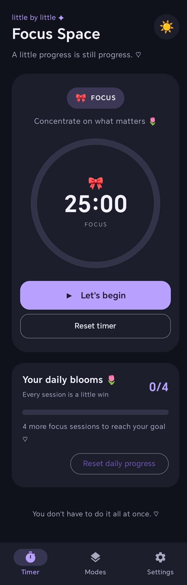
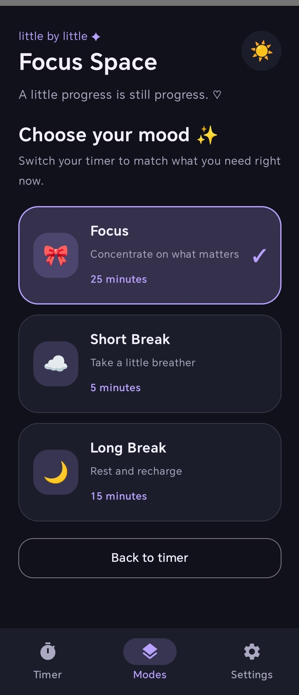
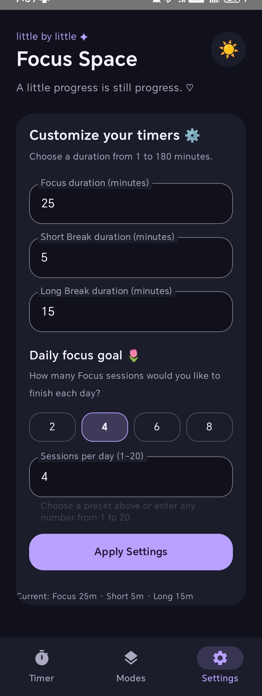

# 🌸 Focus Timer — A Cute Productivity App

A customizable Android focus timer designed to make productive study sessions simple, enjoyable, and distraction-free. Built with **Kotlin** and **Jetpack Compose**, Focus Timer combines a cute pastel-inspired interface with practical productivity features.

## ✨ Features

- ⏱️ **Pomodoro Timer** — Manage focus sessions with a countdown timer.
- ☕ **Multiple Timer Modes** — Switch between Focus, Short Break, and Long Break sessions.
- 🎨 **Customizable Durations** — Adjust timer lengths to suit your workflow.
- 🌙 **Theme Customization** — Switch between light and dark themes.
- 🔔 **Completion Notifications** — Receive notifications when a session ends.
- 🔄 **Background Timer** — Keep the timer running when the app is minimized or the screen is locked.
- 💾 **Persistent Settings** — Save preferences and custom timer durations locally.
- 📊 **Daily Goals** — Set a daily focus-session target and track your progress.
- 🌷 **Cute User Interface** — Enjoy a pastel-inspired design, rounded cards, and timer animations.
- 🚀 **Splash Screen and App Icon** — A personalized launch experience and app branding.

## 🛠️ Tech Stack

- **Language:** Kotlin
- **UI Framework:** Jetpack Compose
- **Development Environment:** Android Studio
- **Background Processing:** Android Foreground Service
- **Local Storage:** DataStore and SharedPreferences
- **Notifications:** Android Notification System
- **Build System:** Gradle

## 📸 Screenshots

### ⏱️ Timer Screen


### 🎨 Modes Screen


### ⚙️ Settings Screen


## 🚀 Getting Started

### Prerequisites

- Android Studio
- Android SDK compatible with the project configuration
- Kotlin and Gradle support
- An Android device or emulator

### Installation

1. Clone this repository:

   ```bash
   git clone https://github.com/YOUR-USERNAME/focus-timer-android.git
   ```

2. Open Android Studio.
3. Select **Open** and choose the cloned project folder.
4. Allow Gradle to sync and download the required dependencies.
5. Connect an Android device or start an emulator.
6. Click **Run ▶** to build and launch the app.

Replace `YOUR-USERNAME` with your GitHub username.

## ⚙️ How to Use

1. Open Focus Timer.
2. Select Focus, Short Break, or Long Break.
3. Customize the duration if needed.
4. Start your timer and focus on your task.
5. Receive a notification when the session finishes.
6. Track your completed focus sessions toward your daily goal.

## 🎯 Project Objective

The goal of Focus Timer is to provide a simple, customizable productivity tool that encourages consistent study habits while demonstrating practical Android development concepts, including declarative UI development, background services, notifications, and local data persistence.

## 🔮 Future Improvements

- Weekly and monthly productivity statistics
- Custom notification sounds
- More theme and color options
- Focus-session history
- Additional timer customization

## 👩‍💻 Author

**Nathasha Vipin**

Computer Science and Engineering Student

[GitHub Profile](https://github.com/YOUR-USERNAME)

---

*Built with Kotlin, Jetpack Compose, and 💜 for more focused days.*